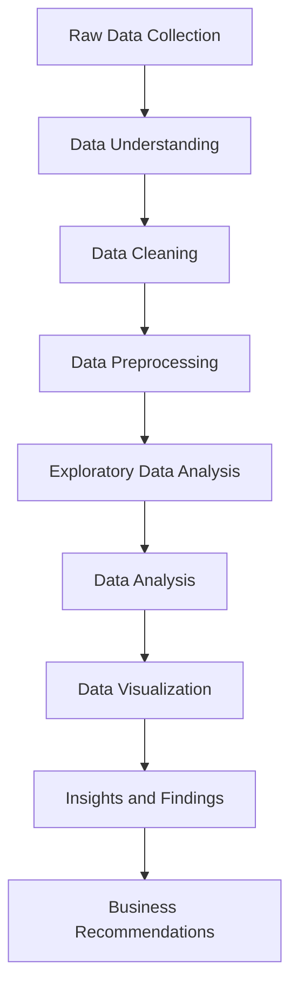

# 📊 End-to-End Data Analytics Project

### Transforming Raw Data into Meaningful Business Insights

[](https://www.python.org/)
[](https://github.com/)
[](https://jupyter.org/)
[](https://github.com/)

---

## 📌 Table of Contents

- [Project Overview](#-project-overview)
- [Project Objectives](#-project-objectives)
- [Business Problem](#-business-problem)
- [Project Workflow](#-project-workflow)
- [Tools and Technologies](#-tools-and-technologies)
- [Dataset Description](#-dataset-description)
- [Data Analytics Process](#-data-analytics-process)
- [Key Analysis Areas](#-key-analysis-areas)
- [Project Structure](#-project-structure)
- [Installation and Setup](#-installation-and-setup)
- [How to Run the Project](#-how-to-run-the-project)
- [Results and Insights](#-results-and-insights)
- [Skills Demonstrated](#-skills-demonstrated)
- [Future Enhancements](#-future-enhancements)
- [Author](#-author)

---

## 📖 Project Overview

The **End-to-End Data Analytics Project** demonstrates the complete data analytics lifecycle, starting from raw data collection and preprocessing to exploratory data analysis, business analysis, and visualization.

The primary objective of this project is to transform raw and unstructured data into meaningful, actionable insights that support data-driven decision-making.

The project uses industry-relevant data analytics tools and techniques to identify patterns, trends, relationships, and important metrics within the dataset.

This project demonstrates practical implementation of data analytics concepts and showcases how data can be used to solve real-world business problems.

---

## 🎯 Project Objectives

The main objectives of this project are:

- Understand and analyze the given dataset.
- Perform data cleaning and preprocessing.
- Identify and handle missing values and duplicate records.
- Conduct Exploratory Data Analysis (EDA).
- Identify patterns, trends, and relationships in the data.
- Perform analytical operations using appropriate tools.
- Create meaningful visualizations to communicate findings.
- Generate actionable insights for business decision-making.
- Develop practical skills in the complete data analytics workflow.

---

## 💡 Business Problem

Organizations generate large amounts of data through their daily operations. However, raw data alone does not provide meaningful information for decision-making.

The major challenge is to convert raw data into useful insights by identifying trends, analyzing performance, and understanding relationships between different variables.

This project addresses the challenge by applying a structured data analytics workflow to:

1. Prepare and clean the available data.
2. Analyze important variables and metrics.
3. Identify meaningful patterns and trends.
4. Present analytical findings through visualizations.
5. Support informed, data-driven decisions.

---

## 🔄 Project Workflow

The project follows a structured end-to-end analytics process:



### Workflow Explanation

| Stage | Description |
|---|---|
| Data Collection | Collect and import the dataset |
| Data Understanding | Understand columns, data types, and structure |
| Data Cleaning | Handle missing values, duplicates, and inconsistencies |
| Data Preprocessing | Prepare the dataset for analysis |
| EDA | Explore distributions, patterns, and relationships |
| Data Analysis | Perform analytical operations and answer relevant questions |
| Visualization | Represent findings using charts and graphs |
| Insights | Identify meaningful observations |
| Recommendations | Suggest possible data-driven improvements |

---

## 🛠️ Tools and Technologies

| Tool / Technology | Purpose |
|---|---|
| Python | Data analysis and processing |
| Pandas | Data manipulation and cleaning |
| NumPy | Numerical operations |
| Matplotlib | Data visualization |
| Seaborn | Statistical visualization |
| Jupyter Notebook | Interactive development and analysis |
| Microsoft Excel | Data inspection and spreadsheet analysis |
| SQL | Data querying and analytical operations |
| Power BI | Interactive dashboards and reporting |

*The exact tools used in the project should match the technologies implemented in the repository.*

---

## 📂 Dataset Description

The dataset serves as the primary source for performing data analysis.

### Dataset Information

| Attribute | Description |
|---|---|
| Dataset Name | [Enter Dataset Name] |
| Data Source | [Enter Dataset Source] |
| File Format | CSV / Excel |
| Number of Records | [Enter Number of Rows] |
| Number of Features | [Enter Number of Columns] |
| Domain | [Enter Project Domain] |

### Dataset Preparation

The dataset is examined to understand:

- Column names and descriptions
- Data types
- Missing values
- Duplicate records
- Unique values
- Data distribution
- Relationships between variables

---

## 🧹 Data Analytics Process

### 1. Data Collection

The dataset is imported into the analytics environment for further processing.

### 2. Data Cleaning

Data cleaning is performed to improve data quality and reliability.

Activities include:

- Identifying missing values
- Removing duplicate records
- Correcting inconsistent values
- Standardizing column names
- Handling incorrect data types
- Identifying potential outliers

### 3. Data Preprocessing

The data is transformed into a suitable format for analysis.

This includes:

- Data type conversion
- Feature transformation
- Data formatting
- Preparing relevant variables
- Creating derived columns where necessary

### 4. Exploratory Data Analysis (EDA)

EDA is conducted to understand the characteristics of the dataset.

The analysis includes:

- Descriptive statistics
- Frequency distributions
- Univariate analysis
- Bivariate analysis
- Multivariate analysis
- Correlation analysis
- Trend identification

### 5. Data Visualization

Visualizations are created to communicate findings effectively.

Examples include:

- Bar charts
- Line charts
- Pie charts
- Histograms
- Scatter plots
- Box plots
- Heatmaps

### 6. Insight Generation

The final stage focuses on interpreting the results and identifying meaningful insights that can support decision-making.

---

## 📈 Key Analysis Areas

The project focuses on analyzing relevant aspects of the dataset, such as:

- Overall dataset performance
- Distribution of important variables
- Category-wise analysis
- Trend analysis
- Comparative analysis
- Relationship between different variables
- Identification of significant patterns
- Performance evaluation using relevant metrics

*Replace these areas with the exact business questions addressed in your notebook or dashboard.*

---

## 📁 Project Structure

```text
Data-Analytics-Project-End-to-End/
│
├── data/
│   ├── raw/
│   └── processed/
│
├── notebooks/
│   └── data_analysis.ipynb
│
├── sql/
│   └── analysis_queries.sql
│
├── dashboard/
│   └── dashboard.pbix
│
├── images/
│   └── visualizations/
│
├── reports/
│   └── analysis_report.pdf
│
├── requirements.txt
│
└── README.md
```

*This is a suggested structure. Update it to reflect the actual files and folders in your repository.*

---

## 🚀 Installation and Setup

### Prerequisites

Make sure the following are installed:

- Python 3.x
- Jupyter Notebook or VS Code
- Git
- Required Python libraries

### Step 1: Clone the Repository

```bash
git clone https://github.com/nNithinbabbu/Data-Analytics-Project-End-to-End.git
```

### Step 2: Navigate to the Project Directory

```bash
cd Data-Analytics-Project-End-to-End
```

### Step 3: Create a Virtual Environment

```bash
python -m venv venv
```

Activate the environment:

**Windows**

```bash
venv\Scripts\activate
```

**macOS / Linux**

```bash
source venv/bin/activate
```

### Step 4: Install Dependencies

If the repository contains a `requirements.txt` file:

```bash
pip install -r requirements.txt
```

Otherwise, install the required libraries:

```bash
pip install pandas numpy matplotlib seaborn jupyter
```

---

## ▶️ How to Run the Project

1. Clone the repository.
2. Install the required dependencies.
3. Open the project folder in VS Code or Jupyter Notebook.
4. Locate the main analysis notebook.
5. Ensure the dataset is available at the expected path.
6. Execute the notebook cells sequentially.
7. Review the analysis outputs, visualizations, and findings.

To launch Jupyter Notebook:

```bash
jupyter notebook
```

---

## 📊 Results and Insights

The project produces analytical outputs that help understand the dataset and identify meaningful patterns.

### Key Outcomes

- Improved data quality through cleaning and preprocessing.
- Better understanding of the dataset through exploratory analysis.
- Identification of patterns and relationships.
- Visual representation of analytical findings.
- Generation of actionable insights.
- Improved understanding of how analytics supports business decisions.

### Major Findings

| Analysis | Key Finding |
|---|---|
| Overall Analysis | [Add your key finding] |
| Trend Analysis | [Add your key finding] |
| Category Analysis | [Add your key finding] |
| Comparative Analysis | [Add your key finding] |
| Business Insights | [Add your key finding] |

---

## 📸 Project Visualizations

Add your dashboard or visualization screenshots below.

```markdown

```

Example:


*Replace the image path with the actual screenshot stored in your repository.*

---

## 🧠 Skills Demonstrated

This project demonstrates practical knowledge of:

- Data Cleaning
- Data Preprocessing
- Exploratory Data Analysis
- Statistical Analysis
- Data Visualization
- Python Programming
- Pandas and NumPy
- SQL Querying
- Business Intelligence
- Analytical Thinking
- Problem-Solving
- Data-Driven Decision-Making

---

## 🔮 Future Enhancements

Potential improvements to the project include:

- Automating the data cleaning and processing pipeline.
- Integrating additional data sources.
- Developing more interactive dashboards.
- Implementing advanced statistical analysis.
- Adding predictive analytics and machine learning.
- Deploying dashboards for online access.
- Implementing automated data refresh.
- Building a complete analytics reporting system.

---

## 👨‍💻 Author

**Potta Nithin**

B.Tech – Artificial Intelligence and Data Science

Interested in Data Analytics, Data Science, Python, SQL, and Business Intelligence.

### Connect with Me

- GitHub: [nNithinbabbu](https://github.com/nNithinbabbu)
- LinkedIn: [Connect with me](https://www.linkedin.com/in/nithinpotta/)

---

## ⭐ Support

If you find this project useful or interesting, consider giving the repository a ⭐ on GitHub.

Thank you for visiting my project!
